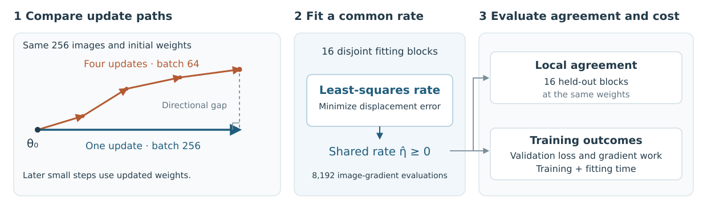

<div align="center">
  <h1>Can One Large-Batch Step Match Four Small Steps?</h1>
  <h3>Training Efficiency on Fashion-MNIST</h3>
  <p><a href="https://github.com/sznnzs">Zhenning Shi</a><br>The Hong Kong Polytechnic University</p>
  <p><em>COMP6704 Advanced Topics in Optimization · Individual Project · Fall 2026</em></p>
  <a href="./study.py"></a>
  <a href="./results"></a>
  <a href="#quick-start"></a>
</div>

<p align="center">
  <a href="#abstract">Abstract</a> ·
  <a href="#method">Method</a> ·
  <a href="#results">Results</a> ·
  <a href="#quick-start">Reproduction</a> ·
  <a href="#repository">Repository</a>
</p>

<a name="abstract"></a>

## 📖 Abstract

One stochastic gradient descent (SGD) update on 256 images uses the same examples as four updates on batches of 64, but the small steps evaluate gradients at successively updated weights. This study asks how much of their net displacement a single learning rate can recover. On Fashion-MNIST, a least-squares fit reduces held-out relative displacement error by a median **28.3%** over linear scaling, while most residual squared error lies perpendicular to the large-batch gradient. Refitted and grid-selected SGD both finish at median validation cross-entropy **0.320** after 15 epochs, with additional calibration work for refitting. A paired comparison of SGD, momentum SGD and Adam also finds that batch 64 needs fewer images to reach a common training loss, whereas batch 256 reaches it sooner on the GPU.

<div align="center">
  
  <p><em>Step-matching overview: compare local updates, fit a common rate and evaluate training outcomes.</em></p>
</div>

<a name="method"></a>

## 🔬 Method

For each block of 256 training images, compute its gradient $g_b$ at the current weights $\theta_0$. On a copy of the model, take four SGD steps of 64 images at learning rate 0.1 and record the descent displacement $d_b = \theta_0 - \theta_{4,b}$. The common nonnegative rate that best matches these displacements is

$$
\widehat{\eta}
= \underset{\eta \geq 0}{\arg\min} \sum_b \lVert d_b - \eta g_b \rVert_2^2
= \max\left(0,\frac{\sum_b g_b^\top d_b}{\sum_b \lVert g_b\rVert_2^2}\right),
$$

when the denominator is positive. Only the fitted rate enters training; the four-step copies are used for calibration.

- **Fit:** use 16 disjoint blocks at initialization, with optional refits after epochs 1 and 5. Each fit costs 8,192 image-gradient evaluations.
- **Evaluate:** measure displacement error on 16 separate blocks from the training split, held out from fitting at that checkpoint.
- **Compare:** train seven learning-rate policies on five new paired seeds, tracking validation loss, gradient work and GPU time.

A scalar rate changes the length of the large update along its gradient. Any displacement component perpendicular to that gradient remains unmatched. [Implementation](step_matching.py) · [Error decomposition](matching_analysis.py)

<a name="results"></a>

## 📊 Results

### Matching the local displacement

The fitted rate improves on linear scaling at **all 15 seed–checkpoint pairs**: five seeds, each measured at initialization and after epochs 1 and 5. The median relative error reduction is **28.3%**. A median **94.9% of the remaining squared error** comes from components perpendicular to the corresponding block gradients.

<div align="center">
  <a href="./figures/calibration.pdf"></a>
  <p><em>Left: fitted learning rates across five seeds. Right: held-out relative displacement error for linear scaling, noise matching and the fitted rate.</em></p>
</div>

### Training quality and cost

Refitted and grid-selected SGD both reach a median validation cross-entropy (CE) that rounds to **0.320**, while refitting adds calibration work.

| Policy | Batch | Validation CE ↓ | Gradient work to target ↓ | Training + fitting (s) ↓ |
| --- | ---: | ---: | ---: | ---: |
| Small-batch reference | 64 | 0.352 | 12,288 | 4.42 |
| Unchanged rate | 256 | 0.325 | 38,912 | 1.13 |
| Noise matched | 256 | 0.321 | 24,576 | 1.13 |
| Grid selected | 256 | **0.320** | 24,576 | 1.13 |
| Linear scaling | 256 | 0.339 | 34,816 | 1.13 |
| Fit once | 256 | 0.323 | 34,816 | 1.17 |
| Refit twice | 256 | **0.320** | 34,816 | 1.22 |

Five-seed medians. Validation CE and time are measured after 15 epochs. **Gradient work to target** counts image-gradient evaluations needed to reach full-training CE ≤ 0.50, including fitting. Time covers training and fitting; full-dataset evaluation, the displacement audit and the initial learning-rate grid search are excluded. [Per-run results](results/step_summary.csv)

### Batch size and optimizer efficiency

Across all three optimizers, batch 64 reaches the training target with fewer images, while batch 256 reaches it in less GPU time.

| Optimizer | Images at batch 64 | Images at batch 256 | Speedup at batch 256 |
| --- | ---: | ---: | ---: |
| SGD | 14,336 | 26,624 | 2.24× |
| Momentum SGD | 14,336 | 20,480 | 3.08× |
| Adam | 10,240 | 20,480 | 2.29× |

Image counts are medians across three seeds. Speedup is the median of the paired ratios `T64 / T256`. GPU time covers updates with data already on the device and excludes warm-up, data loading and full-dataset evaluation. [Paired measurements](results/paired_summary.json) · [Loss curves](figures/convergence.pdf) · [Time and image comparison](figures/target.pdf)

<details>
<summary><strong>Experimental protocol and learning-rate policies</strong></summary>

| Setting | Value |
| --- | --- |
| Dataset | [Fashion-MNIST](https://github.com/zalandoresearch/fashion-mnist): 54,000 training, 6,000 validation and 10,000 official test images |
| Split and preprocessing | Split seed 6704; 600 validation images per class; standardization uses training pixel statistics |
| Network | 784–128–10 multilayer perceptron with a ReLU hidden layer; 101,770 parameters |
| Training budget | 15 epochs, or 810,000 training images processed per run |
| Main comparison | SGD, momentum SGD and Adam at batch sizes 64 and 256; seeds 7, 19 and 43 |
| Learning-rate selection | Four candidates per optimizer and batch size, five epochs each on seed 101; select by validation CE |
| SGD follow-up | Seven policies on seeds 131, 137, 149, 151 and 157; 35 runs in total |

Within each seed, configurations share the same initial weights and shuffled image order. The main comparison evaluates the official test set after training; the SGD follow-up compares validation loss. The selected baseline rates are recorded in [selected.json](results/selected.json).

| Policy | Record key | Batch | Learning rate or fitting schedule |
| --- | --- | ---: | --- |
| Small-batch reference | `reference` | 64 | 0.1 |
| Unchanged rate | `constant` | 256 | 0.1 |
| Noise matched | `noise` | 256 | Approximately 0.20036; preserves one-step sampling error at fixed weights |
| Grid selected | `tuned` | 256 | 0.3, selected on tuning seed 101 |
| Linear scaling | `linear` | 256 | 0.4, four times the small-batch rate |
| Fit once | `once` | 256 | Fit at initialization and keep the rate fixed |
| Refit twice | `refresh` | 256 | Fit at initialization, then refit after epochs 1 and 5 |

The first observed full-training CE at or below 0.50 is recorded on a grid of 2,048 images, with a check at epoch end. For the main optimizer comparison, each first-epoch trajectory is replayed five times. Its median time to target is used to form the within-seed batch-size ratio; the table reports the median of the three ratios. GPU synchronization brackets batch indexing, forward and backward passes, and optimizer updates.

</details>

<details>
<summary><strong>Reading the displacement measurements</strong></summary>

In [calibration_summary.csv](results/calibration_summary.csv), the 15 rows with `rule=refresh` provide the five-seed, three-checkpoint comparison.

- `audit_error` is the pooled relative displacement error on blocks held out from fitting; `linear_error` uses linear scaling on the same blocks and weights.
- `1 - audit_error / linear_error` gives the relative error reduction for one seed–checkpoint pair.
- `(audit_direction_floor / audit_error) ** 2` gives the share of residual squared error from perpendicular displacement.

</details>

<a name="quick-start"></a>

## 🚀 Reproduction

### Rebuild the archived figures and tables

```bash
git clone https://github.com/sznnzs/fashion-mnist-step-matching
cd fashion-mnist-step-matching
python -m pip install -r requirements.txt
python analyze.py
```

Rebuilds **four vector figures, the calibration PNG and seven tables** from saved measurements on a CPU. Outputs: [figures/](figures) and [tables/](tables).

### Repeat the training on a GPU

Recorded environment: **Python 3.12.3, NumPy 2.5.5, [PyTorch 2.9.1 with CUDA 12.8](https://pytorch.org/get-started/previous-versions/)** and an **NVIDIA RTX PRO 5000 72GB Blackwell** GPU. Run in an existing GPU allocation:

```bash
python -m pip install torch==2.9.1 --index-url https://download.pytorch.org/whl/cu128
STUDY_PYTHON=python bash run.sh all
```

The [launcher](run.sh) downloads and verifies Fashion-MNIST in `data/` and writes new measurements to `replication/`.

<details>
<summary><strong>Submit through Slurm on the course cluster</strong></summary>

From the repository root:

```bash
mkdir -p logs
STUDY_PYTHON="$(command -v python)" sbatch --gres=gpu:pilot:1 -o 'logs/%j.out' run.sh all
```

The `gpu:pilot` resource name is specific to the course cluster. `STUDY_PYTHON` selects the training interpreter.

</details>

### Compare a fresh run with the archive

After training finishes:

```bash
STUDY_RESULTS="$PWD/replication" python analyze.py
python verify_replication.py replication --output replication/reproduction_check.json
```

Figures and tables are written to `replication/report_assets/`; numerical differences and timing ratios are saved to `replication/reproduction_check.json`. [Recorded comparison](results/reproduction_check.json)

<a name="repository"></a>

## 📁 Repository

| Experiment | Implementation | Records and figures |
| --- | --- | --- |
| Compare optimizers | [study.py](study.py) | [Tuning runs](results/tune) · [Main runs](results/main) · [Loss curves](figures/convergence.pdf) |
| Measure time and images to target | [early.py](early.py) | [Five replay rounds](results/timing) · [Paired comparisons](figures/target.pdf) |
| Measure gradient noise at identical weights | [probe.py](probe.py) | [Individual draws](results/probe.json) · [Estimates and exact values](tables/probe.tex) |
| Match one large SGD step to four small steps | [step_matching.py](step_matching.py) · [matching_analysis.py](matching_analysis.py) | [Per-run records](results/step_matching) · [Fixed-rate controls](figures/rate_response.pdf) · [Held-out fit](figures/calibration.pdf) |

Dataset loading: [data_io.py](data_io.py). Figure and table generation: [analyze.py](analyze.py).
