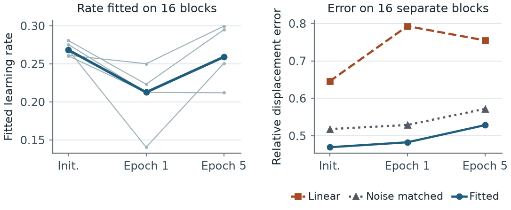

# Can One Large-Batch Step Match Four Small Steps?

One SGD update on 256 images sees the same examples as four updates on batches of 64. The four small steps evaluate gradients at successively updated weights. This study measures how closely a single learning rate can match their total displacement when training a 784–128–10 ReLU network on Fashion-MNIST.

Fitting the large-batch learning rate reduced displacement error relative to linear scaling at all 15 checkpoints across five seeds, with a median reduction of **28.3%**. Most of the remaining error was perpendicular to the large-batch gradient. Fitting cost extra gradient evaluations, and the refitted and grid-selected rates both reached a median validation loss of **0.320** after 15 epochs. [Training results](results/step_summary.csv) · [Calibration measurements](results/calibration_summary.csv)



## Rebuild the figures and tables on a CPU

```bash
git clone https://github.com/sznnzs/fashion-mnist-step-matching
cd fashion-mnist-step-matching
python -m pip install -r requirements.txt
python analyze.py
```

The script reads the archived measurements, checks the paired runs, and regenerates four vector figures, the preview above and seven tables. Once the dependencies are installed, this runs offline. [Figures](figures) · [Tables](tables)

## Results

All three optimizers reached full-training cross-entropy 0.50 with fewer images at batch 64 and in less time at batch 256. The image counts below are medians across three seeds. Speedup is the median of the within-seed time ratios. [Paired comparisons](results/paired_summary.json) · [Per-run measurements](results/summary.csv)

| Optimizer | Images at batch 64 | Images at batch 256 | Speedup at batch 256 |
| --- | ---: | ---: | ---: |
| SGD | 14,336 | 26,624 | 2.24× |
| Momentum SGD | 14,336 | 20,480 | 3.08× |
| Adam | 10,240 | 20,480 | 2.29× |

| Experiment | Implementation | Results to inspect |
| --- | --- | --- |
| Compare optimizers across a common image budget and time to target | [Training and custom updates](study.py) · [First-epoch replays](early.py) | [Loss curves](figures/convergence.pdf) · [Paired time and image counts](figures/target.pdf) |
| Measure gradient noise at identical weights | [Gradient sampling](probe.py) | [Estimates and exact values](tables/probe.tex) · [Individual draws](results/probe.json) |
| Fit one large SGD update to four small updates | [Learning-rate fit](step_matching.py) · [Error analysis](matching_analysis.py) | [Fixed-rate controls](figures/rate_response.pdf) · [Held-out fit](figures/calibration.pdf) · [Cost to target](tables/matched_rules.tex) |

The data split reserves 600 images per class for validation, leaving 54,000 for training. Each optimizer and batch size uses four candidate learning rates on tuning seed 101. Within each of seeds 7, 19 and 43, all configurations share the same initialization and image order. The first epoch is replayed five times, checking training loss every 2,048 images. [Dataset](https://github.com/zalandoresearch/fashion-mnist) · [Selected rates](results/selected.json)

The SGD follow-up compares seven policies on five new seeds. Each fit uses 16 training blocks and is evaluated on 16 disjoint blocks. In the calibration CSV, the 15 `refresh` rows cover the three checkpoints in the plot. The squared ratio `(audit_direction_floor / audit_error) ** 2` gives the share of fitted squared error perpendicular to the block gradients. [Block-level records](results/step_matching)

## Repeat the training on a GPU

The recorded runs used Python 3.12, NumPy 2.5.5, PyTorch 2.9.1 with CUDA 12.8, and an NVIDIA RTX PRO 5000 72GB Blackwell GPU. One GPU runs the complete study. Install a CUDA-compatible PyTorch build in the training environment. [PyTorch installation](https://pytorch.org/get-started/previous-versions/)

From the repository root, submit to the course cluster through Slurm.

```bash
mkdir -p logs
sbatch --gres=gpu:pilot:1 -o 'logs/%j.out' run.sh all
```

In an existing GPU allocation, run `STUDY_PYTHON=python bash run.sh all`. The launcher downloads the dataset to `data/`, checks its published digests and writes the new measurements to `replication/`.

After the job finishes, regenerate its figures and compare its losses, accuracies and fitted rates with the archived run.

```bash
STUDY_RESULTS="$PWD/replication" python analyze.py
python verify_replication.py replication
```

The new figures and tables appear in `replication/report_assets/`. The comparison prints the largest observed numerical differences and the measured timing ratios. [Independent GPU replication](results/reproduction_check.json)
